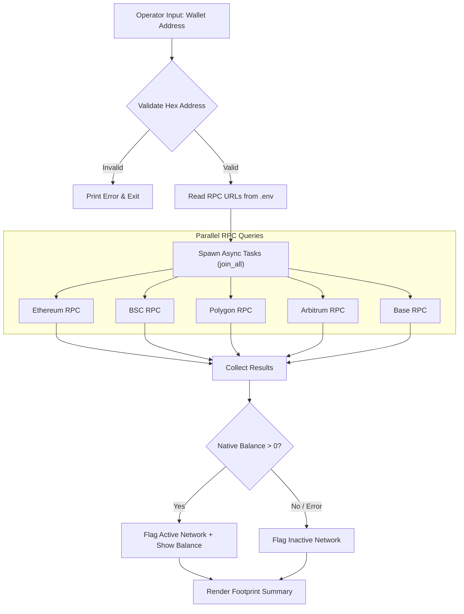

# Multichain EVM Footprint Scanner

A parallel command-line tool written in Rust to scan wallet activity across EVM blockchains.

## Overview

This tool inspects a single EVM wallet address across multiple networks simultaneously.
It queries native coin balances using public or private JSON-RPC endpoints.
The scanner determines network activity by checking for non-zero balances.

### Monitored Networks
- Ethereum Mainnet
- BNB Smart Chain (BSC)
- Polygon PoS
- Arbitrum One
- Base

---

## Process Flow



---

## Prerequisites

- [Rust & Cargo](https://www.rust-lang.org/) (2024 edition supported, Rust 1.85+)
- Valid RPC endpoints for the supported chains (e.g., Ankr, Infura, Alchemy, or public nodes)

---

## Configuration

1. Copy the example configuration file:
   ```bash
   cp .env.example .env
   ```

2. Open `.env` and set your RPC endpoint URLs:
   ```env
   RPC_ETHEREUM=https://rpc.ankr.com/eth
   RPC_BSC=https://rpc.ankr.com/bsc
   RPC_POLYGON=https://rpc.ankr.com/polygon
   RPC_ARBITRUM=https://rpc.ankr.com/arbitrum
   RPC_BASE=https://rpc.ankr.com/base
   ```

---

## Usage

1. Build and run the project using Cargo:
   ```bash
   cargo run
   ```

2. Enter the EVM wallet address when prompted:
   ```text
   Enter wallet address to scan: 0xd8dA6BF26964aF9D7eEd9e03E53415D37aA96045
   ```

3. Review the terminal output:
   ```text
   Scanning multichain footprint for wallet: 0xd8da6bf26964af9d7eed9e03e53415d37aa96045
   Probing 5 networks in parallel...

   --- SCAN RESULTS ---
   + [ACTIVE] Ethereum Mainnet
       └─ Balance: 142.5021 ETH/Native
       └─ RPC Used: https://rpc.ankr.com/eth
   + [ACTIVE] Base
       └─ Balance: 0.1250 ETH/Native
       └─ RPC Used: https://rpc.ankr.com/base
   - [INACTIVE] Binance Smart Chain
   - [INACTIVE] Polygon PoS
   - [INACTIVE] Arbitrum One
   ```

---

## Key Rust Crates Used

- [`ethers`](https://crates.io/crates/ethers) — Ethereum client library for RPC queries and data formatting.
- [`tokio`](https://crates.io/crates/tokio) — Asynchronous runtime for concurrent network operations.
- [`futures`](https://crates.io/crates/futures) — Combinators like `join_all` for parallel task execution.
- [`dotenvy`](https://crates.io/crates/dotenvy) — Environment variable management via `.env`.
